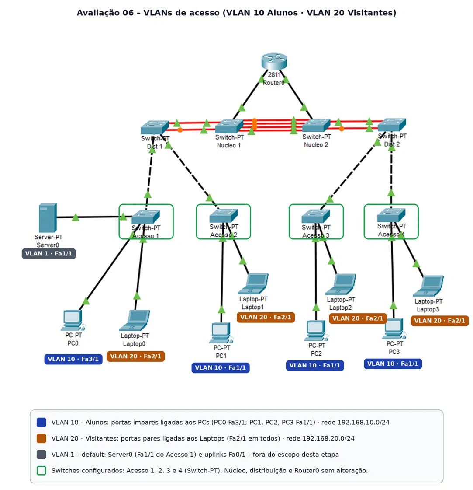
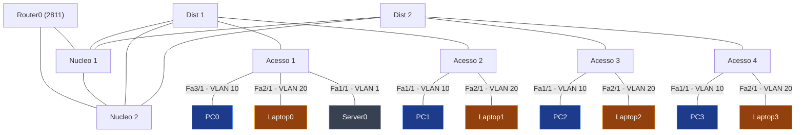
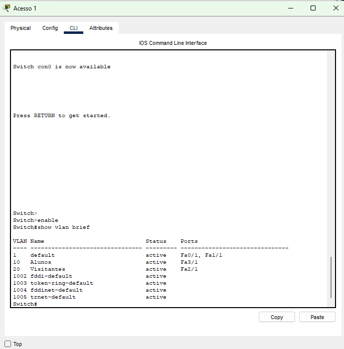
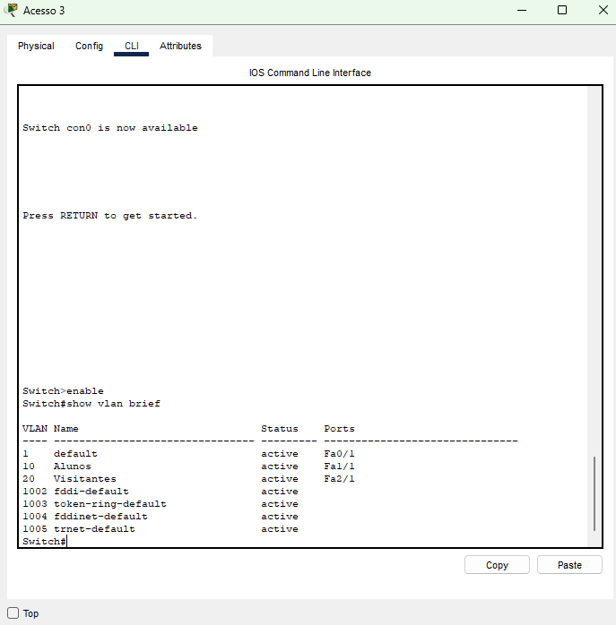
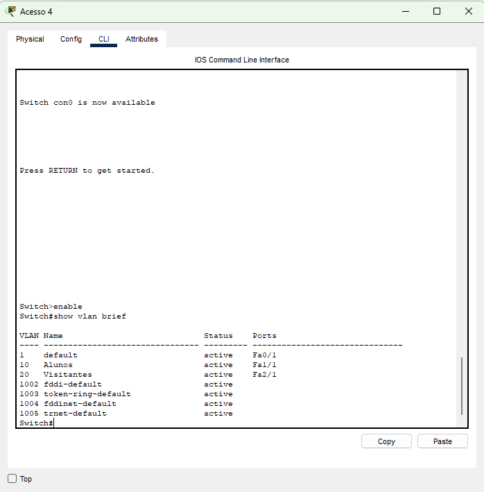
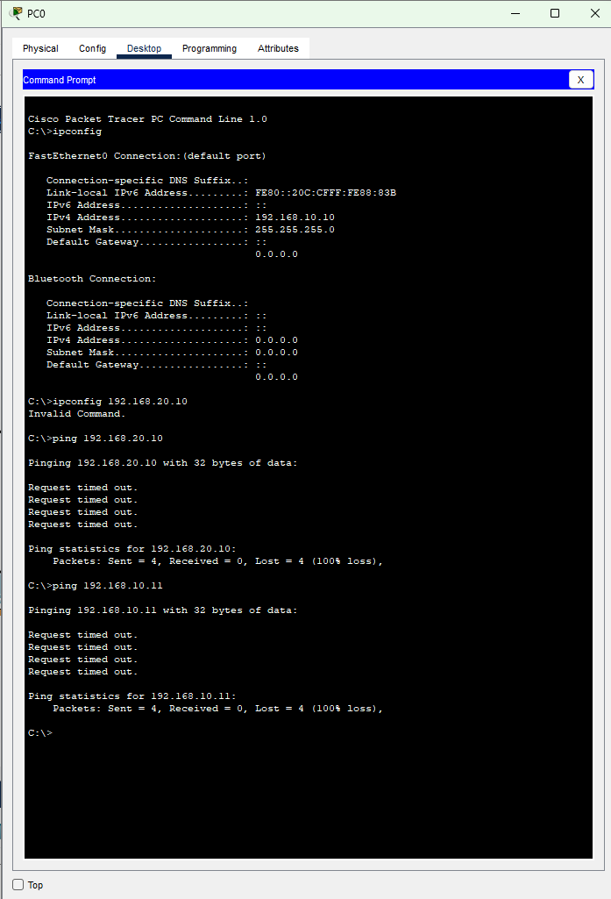

# Avaliação 06 – Configuração de VLANs tipo Acesso em Ambiente Hierárquico

**Disciplina:** TCN.0639 – Comutação de Redes Locais  
**Curso:** Redes de Computadores – IFRO Campus Porto Velho Zona Norte  
**Aluno:** Saulo  
**Ferramenta:** Cisco Packet Tracer  
**Equipamentos:** Router0 (2811); Nucleo 1 e Nucleo 2; Dist 1 e Dist 2; Acesso 1 a Acesso 4 (todos Switch-PT)

---

## 1. Objetivo

Configurar duas VLANs nos switches da **camada de acesso** do ambiente hierárquico simulado:

- **VLAN 10 – Alunos:** portas ímpares ligadas aos computadores (PCs).
- **VLAN 20 – Visitantes:** portas pares ligadas aos notebooks (Laptops).
- As portas que interligam os switches (uplinks) **não** fazem parte desta etapa.

## 2. Topologia

### 2.1 Diagrama atualizado (Packet Tracer)



### 2.2 Diagrama lógico



## 3. Plano de VLANs

| VLAN ID | Nome | Uso | Regra das portas |
|---|---|---|---|
| 10 | Alunos | Computadores (PCs) | Portas ímpares |
| 20 | Visitantes | Notebooks (Laptops) | Portas pares |
| 1 | default | VLAN padrão | Uplinks e portas não usadas (sem alteração) |

Switches configurados: `Acesso 1`, `Acesso 2`, `Acesso 3`, `Acesso 4` (camada de acesso). Núcleo e distribuição não foram alterados.

> **Observação sobre a numeração:** no Switch-PT as interfaces seguem o formato `FastEthernetX/1`. A paridade (ímpar/par) foi aplicada ao número do módulo **X**.

## 4. Endereçamento IP

Uma rede por VLAN. Máscara 255.255.255.0 (/24). Default Gateway em branco (o roteamento entre VLANs não faz parte desta atividade; os endereços .1 ficam reservados).

| Dispositivo | VLAN | Rede | IP | Máscara |
|---|---|---|---|---|
| PC0 | 10 – Alunos | 192.168.10.0/24 | 192.168.10.10 | 255.255.255.0 |
| PC1 | 10 – Alunos | 192.168.10.0/24 | 192.168.10.11 | 255.255.255.0 |
| PC2 | 10 – Alunos | 192.168.10.0/24 | 192.168.10.12 | 255.255.255.0 |
| PC3 | 10 – Alunos | 192.168.10.0/24 | 192.168.10.13 | 255.255.255.0 |
| Laptop0 | 20 – Visitantes | 192.168.20.0/24 | 192.168.20.10 | 255.255.255.0 |
| Laptop1 | 20 – Visitantes | 192.168.20.0/24 | 192.168.20.11 | 255.255.255.0 |
| Laptop2 | 20 – Visitantes | 192.168.20.0/24 | 192.168.20.12 | 255.255.255.0 |
| Laptop3 | 20 – Visitantes | 192.168.20.0/24 | 192.168.20.13 | 255.255.255.0 |
| Server0 | 1 – default | 192.168.1.0/24 | 192.168.1.10 | 255.255.255.0 |

## 5. Mapeamento das interfaces

| Switch | Interface | Dispositivo | Modo | VLAN |
|---|---|---|---|---|
| Acesso 1 | FastEthernet3/1 | PC0 | access | 10 – Alunos |
| Acesso 1 | FastEthernet2/1 | Laptop0 | access | 20 – Visitantes |
| Acesso 1 | FastEthernet1/1 | Server0 | sem alteração | 1 – default |
| Acesso 1 | FastEthernet0/1 | Uplink → Dist 1 | sem alteração (fora do escopo) | 1 – default |
| Acesso 2 | FastEthernet1/1 | PC1 | access | 10 – Alunos |
| Acesso 2 | FastEthernet2/1 | Laptop1 | access | 20 – Visitantes |
| Acesso 2 | FastEthernet0/1 | Uplink → Dist 1 | sem alteração (fora do escopo) | 1 – default |
| Acesso 3 | FastEthernet1/1 | PC2 | access | 10 – Alunos |
| Acesso 3 | FastEthernet2/1 | Laptop2 | access | 20 – Visitantes |
| Acesso 3 | FastEthernet0/1 | Uplink → Dist 2 | sem alteração (fora do escopo) | 1 – default |
| Acesso 4 | FastEthernet1/1 | PC3 | access | 10 – Alunos |
| Acesso 4 | FastEthernet2/1 | Laptop3 | access | 20 – Visitantes |
| Acesso 4 | FastEthernet0/1 | Uplink → Dist 2 | sem alteração (fora do escopo) | 1 – default |

## 6. Comandos Cisco IOS (sequência completa)

### 6.1 Explicação de cada comando

| Comando | Modo onde é digitado | O que faz |
|---|---|---|
| `enable` | `Switch>` | Entra no modo privilegiado (`Switch#`). |
| `configure terminal` | `Switch#` | Entra no modo de configuração global. |
| `vlan 10` | `Switch(config)#` | Cria a VLAN 10 e entra no modo de VLAN. |
| `name Alunos` | `Switch(config-vlan)#` | Dá o nome "Alunos" à VLAN. |
| `exit` | qualquer submodo | Volta um modo. |
| `interface FastEthernetX/Y` | `Switch(config)#` | Entra na configuração da porta. |
| `description TEXTO` | `Switch(config-if)#` | Registra um texto de identificação na porta. |
| `switchport mode access` | `Switch(config-if)#` | Define a porta como porta de acesso (uma única VLAN). |
| `switchport access vlan N` | `Switch(config-if)#` | Associa a porta à VLAN N. |
| `end` | qualquer modo de configuração | Volta para `Switch#`. |
| `copy running-config startup-config` | `Switch#` | Salva a configuração atual na NVRAM. |
| `show vlan brief` | `Switch#` | Mostra as VLANs e as portas de cada uma. |
| `show interfaces X switchport` | `Switch#` | Mostra o modo e a VLAN de acesso da porta. |
| `show running-config` | `Switch#` | Mostra a configuração em execução. |

### 6.2 Acesso 1

```
enable
configure terminal
vlan 10
 name Alunos
 exit
vlan 20
 name Visitantes
 exit
interface FastEthernet3/1
 description PC0 - VLAN 10 Alunos
 switchport mode access
 switchport access vlan 10
 exit
interface FastEthernet2/1
 description Laptop0 - VLAN 20 Visitantes
 switchport mode access
 switchport access vlan 20
 exit
end
copy running-config startup-config
```

### 6.3 Acesso 2

```
enable
configure terminal
vlan 10
 name Alunos
 exit
vlan 20
 name Visitantes
 exit
interface FastEthernet1/1
 description PC1 - VLAN 10 Alunos
 switchport mode access
 switchport access vlan 10
 exit
interface FastEthernet2/1
 description Laptop1 - VLAN 20 Visitantes
 switchport mode access
 switchport access vlan 20
 exit
end
copy running-config startup-config
```

### 6.4 Acesso 3

```
enable
configure terminal
vlan 10
 name Alunos
 exit
vlan 20
 name Visitantes
 exit
interface FastEthernet1/1
 description PC2 - VLAN 10 Alunos
 switchport mode access
 switchport access vlan 10
 exit
interface FastEthernet2/1
 description Laptop2 - VLAN 20 Visitantes
 switchport mode access
 switchport access vlan 20
 exit
end
copy running-config startup-config
```

### 6.5 Acesso 4

```
enable
configure terminal
vlan 10
 name Alunos
 exit
vlan 20
 name Visitantes
 exit
interface FastEthernet1/1
 description PC3 - VLAN 10 Alunos
 switchport mode access
 switchport access vlan 10
 exit
interface FastEthernet2/1
 description Laptop3 - VLAN 20 Visitantes
 switchport mode access
 switchport access vlan 20
 exit
end
copy running-config startup-config
```

## 7. Validação

Comandos executados em cada switch de acesso:

```
show vlan brief
show interfaces <porta> switchport
show running-config
```

**Acesso 1 – show vlan brief**



**Acesso 2 – show vlan brief**


**Acesso 3 – show vlan brief**



**Acesso 4 – show vlan brief**



### 7.1 Testes de ping (feitos a partir do PC0)

| Origem → Destino | VLANs | Resultado | Motivo |
|---|---|---|---|
| PC0 (192.168.10.10) → Laptop0 (192.168.20.10) | 10 → 20 | Falha (esperado) | VLANs e redes IP diferentes; não há roteamento entre VLANs. |
| PC0 (192.168.10.10) → PC1 (192.168.10.11) | 10 → 10 | Falha (esperado nesta etapa) | Mesma VLAN, mas em switches diferentes; os uplinks ainda não são tronco e só levam a VLAN 1. |



## 8. Observações

- As VLANs 10 e 20 foram criadas nos **quatro** switches de acesso, porque cada switch mantém sua própria base de VLANs.
- As portas de uplink continuam na VLAN 1. A configuração delas (modo tronco) fica para a próxima atividade.
- Por isso, dispositivos da mesma VLAN em switches diferentes ainda não se comunicam.
- Ajuste físico: no Acesso 1, os cabos do PC0 e do Laptop0 foram trocados de porta para seguir a regra (PC em porta ímpar, Laptop em porta par).
- Server0 (Acesso 1): porta mantida na VLAN 1, pois a atividade não define VLAN para o servidor.

## 9. Arquivos do repositório

| Arquivo | Conteúdo |
|---|---|
| `README.md` | Este tutorial |
| `topologia.png` | Diagrama atualizado |
| `show-vlan-*.png` | Saídas do `show vlan brief` |
| `teste-ping.png` | Teste de conectividade |
| `Atividade_06.pkt` | Arquivo do Cisco Packet Tracer |

## 10. Referências

- Slides 06 e 08 da disciplina TCN.0639 (comandos de visualização, criação e atribuição de VLANs).
- IPCisco – VLAN Configuration on Cisco Packet Tracer: https://ipcisco.com/lesson/vlan-configuration-on-cisco-packet-tracer/
